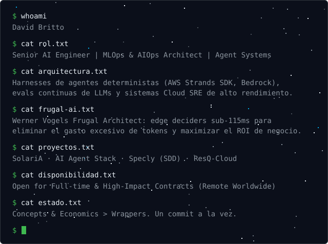
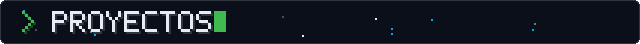
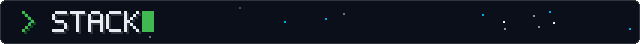
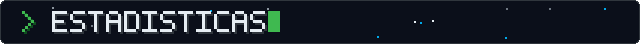
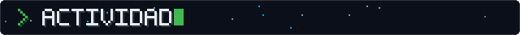
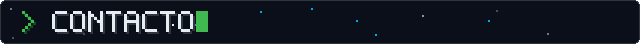

  <a href="https://github.com/DavidBritto/solaria"><b>SolariA</b></a> · <i>Autonomous Solar Telemetry &amp; Frugal AI Synthesis</i> 
  Edge Decider sub-115ms (AWS Strands 2B) + Amazon Bedrock Nova Lite · 100% local fallback uptime · Werner Vogels' Frugal Architect. 
  
  
  
  
  

  <a href="https://github.com/DavidBritto/ai-agent-stack"><b>AI Agent Stack</b></a> · <i>Production Multi-Agent Orchestration &amp; Eval Framework</i> 
  Harness observable con delegación dinámica de subagentes, motor de memoria persistente (Engram), torneos de evaluación y budget guards. 
  
  
  
  

  <a href="https://github.com/DavidBritto/specly"><b>Specly</b></a> · <i>Spec-Driven Development (SDD) Standard for Autonomous AI</i> 
  Estándar de ingeniería que transforma prompts abiertos en contratos inmutables y PRs auditables con bucles de verificación deterministas. 
  
  
  

  <a href="https://github.com/DavidBritto/resq-cloud"><b>ResQ-Cloud</b></a> · <i>Resilient Event-Driven Disaster Triage Platform</i> 
  Ingesta asíncrona masiva (API Gateway directo a SQS, DynamoDB Geohash) y tolerancia a fallos parciales con cero coste en reposo ($0.00 USD). 
  
  
  
  

AGENTIC AI &amp; LLMOPS

  
  
  

  
  
  
  

CLOUD INFRASTRUCTURE &amp; SRE

  
  
  

  
  
  
  

OBSERVABILITY &amp; RELIABILITY

  
  

  
  
  

LANGUAGES &amp; RUNTIMES

  
  
  

  
  
  
  

  
  
  
  

LOCATION: ARGENTINA (UTC-3) · OPEN FOR GLOBAL REMOTE &amp; HIGH-IMPACT ROLES

Escena y títulos: SVG animados generados con Python (<a href="tools/generate_assets.py">tools/generate_assets.py</a>). Código abierto bajo licencia <a href="LICENSE">MIT</a>.

